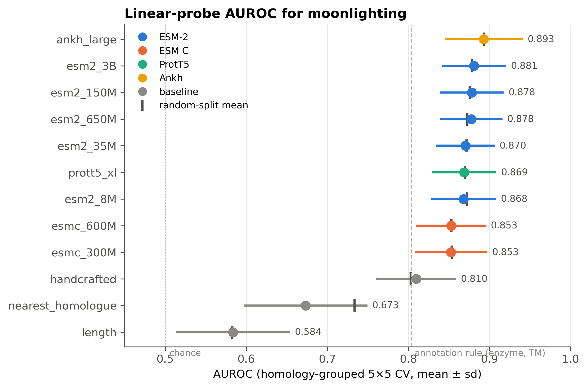
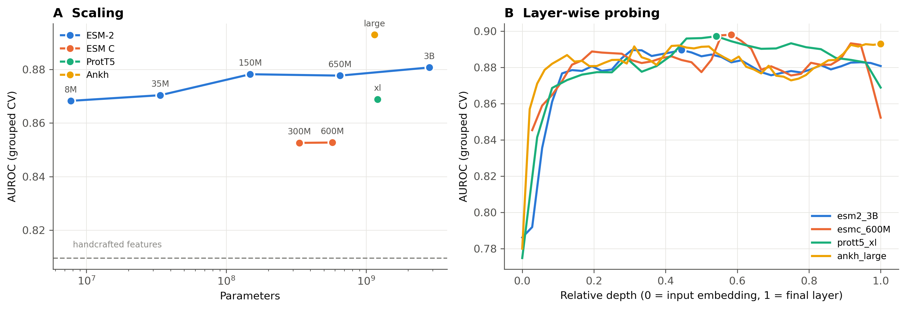
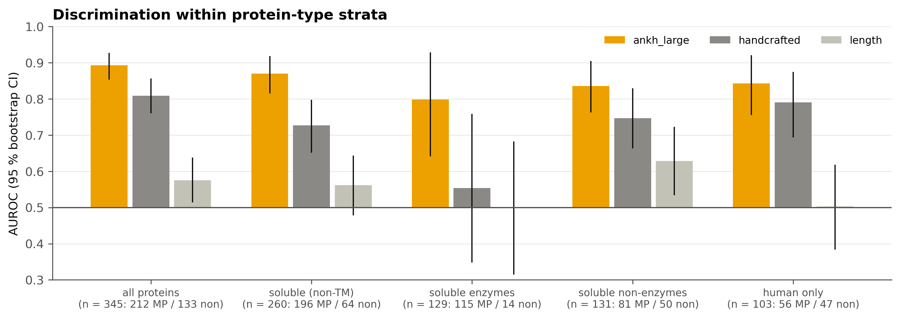

# What do protein language models know about moonlighting?

**Moonlighting proteins** perform two or more unrelated functions with a single polypeptide chain. Enolase, for
example, is both a glycolytic enzyme and a plasminogen receptor. This repository asks what *frozen* embeddings from
nine protein language models (pLMs) encode about moonlighting, using a curated set of 345 proteins, a single linear
probe and homology-aware cross-validation.

Everything is in one notebook: **[`moonlighting_plm.ipynb`](moonlighting_plm.ipynb)**.



## Key findings

| | Finding |
|---|---|
| 1 | **All pLMs beat classical baselines.** AUROC 0.85–0.89 vs 0.81 for composition features, 0.67 for nearest-homologue transfer and 0.58 for length. This holds under homology-grouped CV. |
| 2 | **Scale barely matters.** ESM-2 from 8M → 3B parameters (350×) gains only +0.013 AUROC. |
| 3 | **Layer matters more than model.** Intermediate layers (45–60 % depth) beat final layers by up to +0.05. At their best layers, all families converge on 0.89–0.90. |
| 4 | **The benchmark has a protein-type shortcut.** 54 % of moonlighters are soluble enzymes, while 52 % of non-moonlighters are membrane proteins. A 2-bit annotation rule scores AUROC 0.80. Composition features collapse to chance once protein type is controlled for. **pLMs keep most of their signal** (≈0.80–0.87 within strata). |
| 5 | **pLMs have a blind spot for scaffold-type moonlighting.** They miss multifunctional proteins built from disordered regions and linear motifs, which suggests residue-level models as the next step. |

<p align="center"><br>
</p>

## Models

| Family | Checkpoints | Params |
|---|---|---|
| ESM-2 | `esm2_t6_8M` · `t12_35M` · `t30_150M` · `t33_650M` · `t36_3B` | 8M – 2.8B |
| ESM C | `esmc_300m` · `esmc_600m` | 333M, 575M |
| ProtT5 | `prot_t5_xl_half_uniref50-enc` | 1.2B (encoder) |
| Ankh | `ankh-large` | 1.15B (encoder) |

Embeddings are mean-pooled. Sequences longer than 1,000 residues are embedded in overlapping windows, never truncated.

## Repository layout

```
moonlighting_plm.ipynb      the analysis (runs on CPU in ~10 min from the shipped embeddings)
data/
  raw/                      original Moonlighting / Non-moonlighting spreadsheets
  clean.csv, clean.fasta    curated benchmark (345 proteins)
  folds.json                frozen 5×5 CV folds: random + homology-grouped
  pairwise_identity.npy     Smith-Waterman identity matrix
  uniprot_annotations.csv   names / EC / keywords (interpretation only, never model input)
embeddings/                 final-layer embeddings for 9 pLMs + 2 baselines (*.npy) with metadata (*.json)
results/                    benchmark tables, layer-wise and stratified AUROCs, out-of-fold predictions
figures/                    all figures
scripts/
  prepare_data.py           QC -> homology clusters -> frozen folds
  fetch_uniprot.py          UniProt annotations
  baseline_features.py      length + composition/physicochemical features
  embed.py                  pLM embedding extraction (GPU)
  run_embed.pbs             PBS job: all 9 models on a 3-GPU node (~5 min on 3× RTX 2080 Ti)
```

## Reproduce

```bash
pip install -r requirements.txt
jupyter nbconvert --execute --to notebook --inplace moonlighting_plm.ipynb
```

To regenerate everything from the raw spreadsheets, including the all-layer embeddings that are too large for git:

```bash
python scripts/prepare_data.py && python scripts/fetch_uniprot.py && python scripts/baseline_features.py
# GPU env: torch, transformers==4.48.1, sentencepiece, esm==3.2.1
for m in esm2_8M esm2_35M esm2_150M esm2_650M esm2_3B esmc_300M esmc_600M prott5_xl ankh_large; do
    python scripts/embed.py --model $m
done
```

## Dataset curation

Starting from 215 moonlighting + 136 non-moonlighting UniProt entries, 3 accessions listed in *both* classes were
removed (O75821, P43274, P69786), leaving 345 proteins. There are 320 homology clusters at ≥30 % identity / ≥50 %
coverage. See `results/qc_audit.json`.

## Author & licence

Sutanu Mukhopadhyay · released under the [MIT License](LICENSE).
